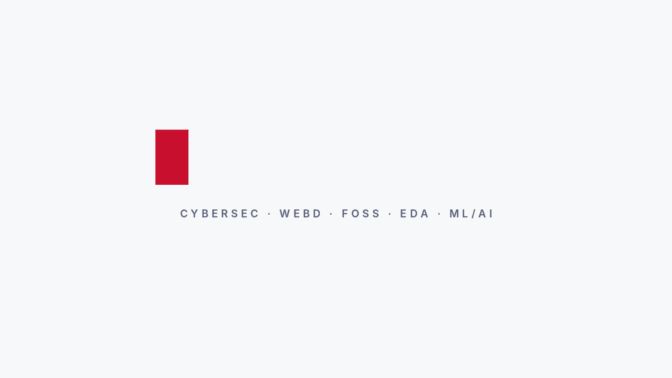

  

# CodeBlooded

A multidisciplinary hackathon team. We build across **cybersecurity, web development, open source, EDA and ML/AI**, and we build in the open.

## What we work on

| Field | What it means for us |
| --- | --- |
| **Cybersec** | CTFs and crackmes |
| **WebD** | Backend-leaning web apps with React, Node, Express, MongoDB, Prisma and MySQL |
| **FOSS** | Open-source practice through the FOSS wing at GeekHaven, IIITA |
| **EDA** | Electronic design automation |
| **ML/AI** | Classical ML from scratch, and applied AI projects |

## Projects

| Project | What it does | Field | Context |
| --- | --- | --- | --- |
| [Civic Architect](https://github.com/joy9168m/civic-architect) | AI-assisted civic issue reporting. Citizens report problems on a live map, AI fills in the details and flags duplicates, and admins track fixes. React, TypeScript, Firebase, Gemini. | WebD, ML/AI | III Hackathon |
| [Url_Shortner](https://github.com/joy9168m/Url_Shortner) | A bit.ly-style URL shortener. | WebD | Personal project |
| [nexis-ai-fitness](https://github.com/icyfire8/nexis-ai-fitness) | AI-powered gym and fitness web app. Next.js frontend, FastAPI backend. Work in progress. | WebD, ML/AI | Personal project |
| [Ml-from-Scratch](https://github.com/joy9168m/Ml-from-Scratch) | Classical machine learning algorithms implemented with only NumPy. | ML/AI | Personal project |
| [Rush](https://github.com/joy9168m/Rush) | A Unix-like shell written from scratch in Rust. | Systems | Personal project |
| [shpp](https://github.com/LooninS/shpp) | A small learning-project shell in C++: runs programs with fork and exec, looks up PATH, and has a few builtins. | Systems | Personal project |
| [thread_race_condition_demo](https://github.com/LooninS/thread_race_condition_demo) | A C pthreads demo of a race condition, with a checker that flags corrupted output. | Cybersec, Systems | Personal project |
| [Character-Frequency-Analyzer](https://github.com/joy9168m/Character-Frequency-Analyzer) | A Python character frequency analysis tool aimed at security use cases. | Cybersec | Personal project |

## Team

| | |
| --- | --- |
| [Sourish Awasthi](https://github.com/LooninS) | Member, FOSS wing, GeekHaven, IIITA |
| [Joydeep Mondal](https://github.com/joy9168m) | Member, FOSS wing, GeekHaven, IIITA |
| [Ankit Pal](https://github.com/icyfire8/) | Member, GDG on Campus, IIITA |

## Work with us

- Found a bug or have an idea? Open an issue on the relevant repo.
- Want to contribute? Check a repo's `CONTRIBUTING.md` if it has one, or open an issue first.
- Want to get in touch? Check the member's LinkedIn.

---

Licensed projects are marked in each repository. Unless a repo says otherwise, assume nothing is licensed for reuse.
